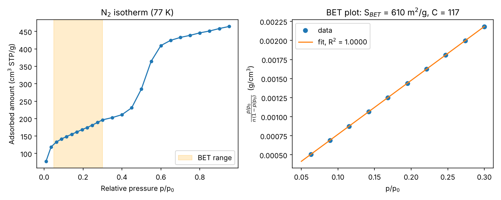

# BET surface area from N2 isotherms

A small Python tool that calculates the **BET specific surface area**, the monolayer capacity and the BET constant **C** from an N2 adsorption isotherm measured at 77 K. It also checks the Rouquerol criteria for the chosen pressure range and plots the isotherm next to the BET plot.

I built it to evaluate isotherms like the ones from my lab course on porous silica (N2 physisorption, Quantachrome NOVA 4000e).

## Method

Linear form of the BET equation:

$$\frac{p/p_0}{n\,(1-p/p_0)} = \frac{1}{n_m C} + \frac{C-1}{n_m C}\,\frac{p}{p_0}$$

A straight line fit in the BET range (default p/p0 = 0.05 to 0.30) gives slope *s* and intercept *i*:

- monolayer capacity $n_m = 1/(s+i)$ (cm³ STP/g)
- BET constant $C = s/i + 1$
- surface area $S_{BET} = n_m \cdot N_A \cdot \sigma_{N_2} / V_m$ with $\sigma_{N_2} = 0.162$ nm² and $V_m = 22414$ cm³/mol

**Rouquerol criteria** (`--rouquerol`): in a valid BET range the term $n(1-p/p_0)$ must increase with $p/p_0$, and C must be positive. This is important for microporous materials, where the standard 0.05 to 0.30 range often gives wrong results.

## Usage

```bash
pip install -r requirements.txt
python bet.py examples/example_isotherm.csv --rouquerol --plot examples/bet_plot.png
python bet.py examples/example_isotherm.csv --range 0.05 0.20
```

Input CSV (adsorption branch):

```csv
p_rel,n_ads_cm3_g
0.036,118.79
0.063,132.88
0.089,141.41
```

## Example output

```
BET fit range p/p0 = 0.05 to 0.3 (10 points)
S_BET            = 610.1 m2/g
Monolayer n_m    = 140.17 cm3 STP/g
BET constant C   = 116.5
R2               = 0.99999
Rouquerol: n(1-p/p0) increases    yes
Rouquerol: C > 0                  yes
```



The example isotherm has the typical type IV shape of a mesoporous silica: a steep rise at low pressure (monolayer), a linear multilayer region, and a capillary condensation step around p/p0 = 0.5 when the mesopores fill.

*The isotherm in `examples/example_isotherm.csv` is an illustrative, simulated data set, not raw lab data.*

## Ideas for next steps

- Pore size distribution with the BJH method from the desorption branch
- Automatic choice of the BET range from the Rouquerol criteria
- Read export files from the instrument software directly
